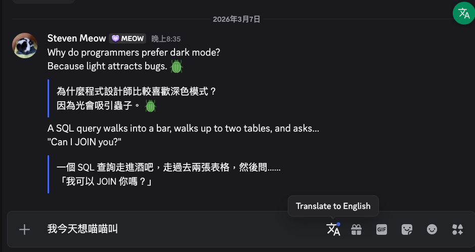

# BabelChat

[English README](./README.md)

一個 [Vencord](https://github.com/Vendicated/Vencord) 插件，透過任何 OpenAI 相容的 LLM API，為 Discord 訊息提供即時雙語翻譯。



## 功能特色

- **行內翻譯** — 翻譯結果直接顯示在原始訊息下方，保留 Discord markdown、表情符號和提及。
- **自動翻譯** — 開啟後自動翻譯所有新進訊息（包含自己發送的）。
- **批量翻譯** — 點擊浮動按鈕，一次翻譯當前頻道中所有可見訊息。
- **撰寫翻譯** — 用母語輸入訊息，點擊聊天欄的翻譯按鈕，輸入框內容會被替換為翻譯後的文字，確認後再送出。
- **右鍵翻譯** — 右鍵點擊任何訊息 > "BabelChat Translate" 即可翻譯。
- **懸停翻譯** — 滑鼠懸停在訊息上，點擊工具列的翻譯圖示。
- **彈性 API** — 支援 OpenAI、Gemini、本地模型（Ollama、LM Studio）或任何 OpenAI 相容端點。
- **16 種語言** — English、繁體中文、简体中文、日本語、한국어、Español、Français、Deutsch、Português、Italiano、Русский、العربية、हिन्दी、Tiếng Việt、ไทย、Bahasa Indonesia。
- **智慧快取** — 翻譯結果快取在記憶體中，避免重複 API 呼叫。
- **自訂系統提示** — 可覆蓋預設的翻譯 prompt。

## 安裝教學

### 一鍵安裝（推薦）

安裝腳本會自動處理所有事情 — 下載 Vencord、複製插件、編譯、注入到 Discord。

> **不熟悉命令列？**
> - **macOS**：打開 **終端機**（按 `Cmd + 空白鍵`，輸入 "Terminal"，按 Enter）
> - **Windows**：打開 **PowerShell**（按 `Win + X`，選擇「Windows PowerShell」或「終端」）
> - **Linux**：打開終端機（通常是 `Ctrl + Alt + T`）

#### 方式 A：使用 Git（已安裝 Git 的話）

**macOS / Linux：**

```bash
git clone https://github.com/stevenyu113228/BabelChat.git
cd BabelChat
bash install.sh
```

**Windows（PowerShell）：**

```powershell
git clone https://github.com/stevenyu113228/BabelChat.git
cd BabelChat
.\install.ps1
```

#### 方式 B：下載 ZIP（不需要 Git）

1. 到 [**Releases 頁面**](https://github.com/stevenyu113228/BabelChat/releases) 或點擊 GitHub 頁面上的綠色 **Code** 按鈕 > **Download ZIP**。
2. 解壓縮 ZIP 檔案。
3. 在解壓縮的資料夾裡打開終端機，然後執行：

**macOS / Linux：**
```bash
bash install.sh
```

**Windows（PowerShell）：**
```powershell
.\install.ps1
```

> **Windows 出現執行原則錯誤？** 先執行這行，再重試：
> ```powershell
> Set-ExecutionPolicy -Scope CurrentUser -ExecutionPolicy RemoteSigned
> ```

#### 腳本會做什麼

1. 檢查並協助安裝前置需求（Git、Node.js v18+、pnpm）
2. 下載 [Vencord](https://github.com/Vendicated/Vencord)（或使用你現有的版本）
3. 將 BabelChat 插件複製到 Vencord
4. 編譯所有東西
5. 提醒你關閉 Discord，然後注入 Vencord
   - 注入器會問你要選哪個 Discord 版本 — **不確定的話選「Discord」（Stable）**

如果你已經有 Vencord 原始碼，可以指定路徑：

```bash
bash install.sh ~/path/to/your/Vencord          # macOS / Linux
.\install.ps1 -VencordPath C:\path\to\Vencord    # Windows
```

#### 安裝完成後

1. **完全重啟 Discord**（要退出再重開，不是只有最小化）。
2. 打開 **設定**（齒輪圖示）> **Vencord** > **Plugins**。
3. 搜尋 **BabelChat** 並**啟用**。
4. 點擊 BabelChat 的**設定齒輪**來設定 API — 參考下方[設定說明](#設定說明)。

### 手動安裝

<details>
<summary>點擊展開手動安裝步驟</summary>

#### 前置需求

- [Git](https://git-scm.com/)
- [Node.js](https://nodejs.org/) v18 以上
- [pnpm](https://pnpm.io/) — 透過 `npm install -g pnpm` 安裝

#### 步驟

1. **下載 Vencord 並安裝相依套件**

   ```bash
   git clone https://github.com/Vendicated/Vencord.git
   cd Vencord
   pnpm install
   ```

2. **下載 BabelChat 並複製插件**

   ```bash
   git clone https://github.com/stevenyu113228/BabelChat.git
   cp -r BabelChat/src/userplugins/babelChat Vencord/src/userplugins/babelChat
   ```

3. **編譯、關閉 Discord、注入**

   ```bash
   cd Vencord
   pnpm build
   pnpm inject    # 先關閉 Discord，詢問時選「Discord」（Stable）
   ```

4. **重啟 Discord**，然後在 **設定 > Vencord > Plugins** 中啟用 BabelChat。

</details>

## 設定說明

啟用 BabelChat 後，點擊它的**設定齒輪**圖示來設定：

| 設定 | 說明 |
|---|---|
| **API Endpoint** | OpenAI 相容 API 網址（預設：`https://api.openai.com/v1/chat/completions`） |
| **API Key** | API 金鑰（本地模型可留空） |
| **Model** | 模型名稱（預設：`gpt-4o-mini`） |
| **Target Language** | 收到的訊息要翻譯成的語言 |
| **Compose Language** | 撰寫訊息時要翻譯成的語言 |
| **Auto Translate** | 自動翻譯所有新訊息 |
| **System Prompt** | 自訂提示詞（使用 `{targetLanguage}` 作為佔位符） |

### 快速開始：OpenRouter（免費，不需信用卡）

最簡單的入門方式 — [OpenRouter](https://openrouter.ai/) 提供免費模型，不需要信用卡：

1. 到 [openrouter.ai](https://openrouter.ai/) 註冊（可用 Google / GitHub 登入）。
2. 到 [API Keys](https://openrouter.ai/keys) 建立一個金鑰。
3. 在 BabelChat 設定中輸入：

```
API Endpoint: https://openrouter.ai/api/v1/chat/completions
API Key:      sk-or-v1-xxxxxxxxxxxx（你的金鑰）
Model:        google/gemma-3-27b-it:free
```

其他免費模型：`meta-llama/llama-3.3-70b-instruct:free`、`qwen/qwen3-4b:free`、`mistralai/mistral-small-3.1-24b-instruct:free`。查看[所有免費模型](https://openrouter.ai/models?q=free)。

### 範例：搭配 Ollama（本地離線）

```
API Endpoint: http://localhost:11434/v1/chat/completions
API Key:（留空）
Model: llama3
```

### 範例：搭配 Google Gemini

```
API Endpoint: https://generativelanguage.googleapis.com/v1beta/openai/chat/completions
API Key: your-gemini-api-key
Model: gemini-2.0-flash
```

## 使用方式

1. **翻譯單則訊息** — 右鍵點擊訊息 > "BabelChat Translate"，或懸停後點擊翻譯圖示。
2. **自動翻譯** — 在設定中啟用 "Auto Translate"，所有新訊息會自動翻譯。
3. **批量翻譯** — 點擊聊天區域右側的浮動翻譯按鈕，翻譯所有可見訊息。
4. **撰寫翻譯** — 在聊天欄用母語輸入文字，點擊撰寫翻譯按鈕（輸入框有文字時才會出現），確認翻譯結果後送出。

## 更新

當 Discord 或 Vencord 更新後，可能需要重新執行安裝腳本：

```bash
cd BabelChat
bash install.sh        # macOS / Linux
.\install.ps1          # Windows
```

腳本會自動拉取最新的 Vencord、重新編譯並注入。

## 解除安裝

要從 Discord 移除 Vencord（和 BabelChat）：

```bash
cd ~/.vencord-src      # 或你的 Vencord 路徑
pnpm uninject
```

然後重啟 Discord。要刪除檔案：

```bash
rm -rf ~/.vencord-src  # macOS / Linux
```

## 常見問題

| 問題 | 解決方式 |
|---|---|
| 插件沒有出現在設定裡 | 確認你已完全重啟 Discord（不是只有最小化）。檢查 Vencord > Plugins 中 BabelChat 是否啟用。 |
| 「Network error」或「API error」 | 檢查 BabelChat 設定中的 API Endpoint 網址和 API Key 是否正確。 |
| 翻譯結果亂碼或品質差 | 試試不同的模型。較大的模型（27B 以上）翻譯品質較好。 |
| Discord 更新後失效 | Discord 更新可能會移除 Vencord。重新執行安裝腳本即可恢復。 |

## 授權條款

MIT
