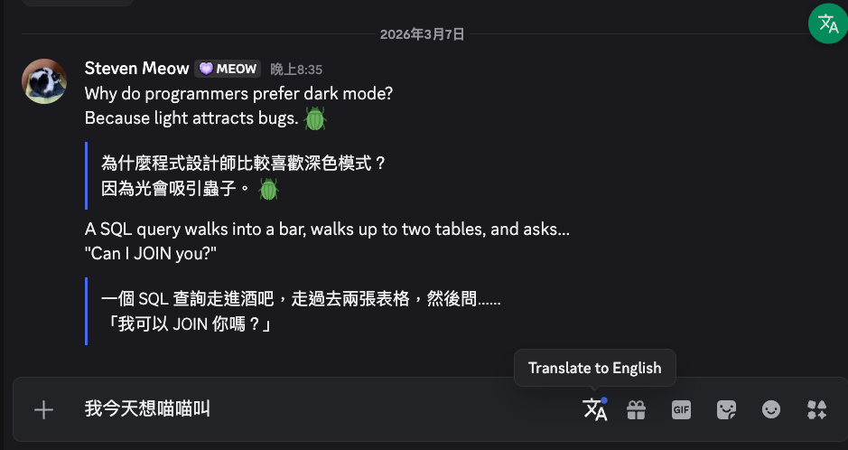

# BabelChat

[中文版 README](./README-zh.md)

A [Vencord](https://github.com/Vendicated/Vencord) plugin that provides real-time bilingual translation for Discord messages, powered by any OpenAI-compatible LLM API.



## Features

- **Inline Translation** — Translated text appears directly below the original message, preserving Discord markdown, emoji, and mentions.
- **Auto-Translate** — Automatically translate all incoming messages (including your own) when enabled.
- **Bulk Translate** — A floating button that translates all visible messages in the current channel at once.
- **Compose Translation** — Type in your native language, click the translate button in the chatbar, and the input is replaced with the translated text before you send.
- **Right-Click Translate** — Translate any individual message via the context menu.
- **Message Hover Translate** — Translate button on message hover toolbar.
- **Flexible API** — Works with OpenAI, Gemini, local models (Ollama, LM Studio), or any OpenAI-compatible endpoint.
- **16 Languages** — English, 繁體中文, 简体中文, 日本語, 한국어, Español, Français, Deutsch, Português, Italiano, Русский, العربية, हिन्दी, Tiếng Việt, ไทย, Bahasa Indonesia.
- **Smart Caching** — Translations are cached in memory to avoid redundant API calls.
- **Custom System Prompt** — Override the default translation prompt with your own.

## Installation

### Quick Install (Recommended)

The install script handles everything automatically — downloading Vencord, copying the plugin, building, and injecting into Discord.

> **New to the command line?**
> - **macOS**: Open **Terminal** (press `Cmd + Space`, type "Terminal", hit Enter)
> - **Windows**: Open **PowerShell** (press `Win + X`, select "Windows PowerShell" or "Terminal")
> - **Linux**: Open your terminal emulator (usually `Ctrl + Alt + T`)

#### Option A: Using Git (if you have Git installed)

**macOS / Linux:**

```bash
git clone https://github.com/stevenyu113228/BabelChat.git
cd BabelChat
bash install.sh
```

**Windows (PowerShell):**

```powershell
git clone https://github.com/stevenyu113228/BabelChat.git
cd BabelChat
.\install.ps1
```

#### Option B: Download ZIP (no Git required)

1. Go to [**Releases**](https://github.com/stevenyu113228/BabelChat/releases) or click the green **Code** button > **Download ZIP** on the GitHub page.
2. Extract the ZIP file.
3. Open a terminal inside the extracted folder, then run:

**macOS / Linux:**
```bash
bash install.sh
```

**Windows (PowerShell):**
```powershell
.\install.ps1
```

> **Windows execution policy error?** Run this first, then try again:
> ```powershell
> Set-ExecutionPolicy -Scope CurrentUser -ExecutionPolicy RemoteSigned
> ```

#### What the script does

1. Checks and helps install prerequisites (Git, Node.js v18+, pnpm)
2. Downloads [Vencord](https://github.com/Vendicated/Vencord) (or uses your existing copy)
3. Copies the BabelChat plugin into Vencord
4. Builds everything
5. Asks you to close Discord, then injects Vencord
   - The injector will ask which Discord version — **pick "Discord" (Stable)** if you're not sure

If you already have Vencord from source, point the script to it:

```bash
bash install.sh ~/path/to/your/Vencord          # macOS / Linux
.\install.ps1 -VencordPath C:\path\to\Vencord    # Windows
```

#### After installation

1. **Restart Discord** completely (quit and reopen — not just minimize).
2. Go to **Settings** (gear icon) > **Vencord** > **Plugins**.
3. Search for **BabelChat** and toggle it **on**.
4. Click the **BabelChat** settings gear to configure your API — see [Configuration](#configuration) below.

### Manual Install

<details>
<summary>Click to expand manual installation steps</summary>

#### Prerequisites

- [Git](https://git-scm.com/)
- [Node.js](https://nodejs.org/) v18+
- [pnpm](https://pnpm.io/) — install via `npm install -g pnpm`

#### Steps

1. **Clone Vencord and install dependencies**

   ```bash
   git clone https://github.com/Vendicated/Vencord.git
   cd Vencord
   pnpm install
   ```

2. **Clone BabelChat and copy the plugin**

   ```bash
   git clone https://github.com/stevenyu113228/BabelChat.git
   cp -r BabelChat/src/userplugins/babelChat Vencord/src/userplugins/babelChat
   ```

3. **Build, close Discord, and inject**

   ```bash
   cd Vencord
   pnpm build
   pnpm inject    # close Discord first, pick "Discord" (Stable) when asked
   ```

4. **Restart Discord**, then enable BabelChat in **Settings > Vencord > Plugins**.

</details>

## Configuration

After enabling BabelChat, click its **settings gear** icon to configure:

| Setting | Description |
|---|---|
| **API Endpoint** | Your OpenAI-compatible API URL (default: `https://api.openai.com/v1/chat/completions`) |
| **API Key** | Your API key (leave empty if not required, e.g. local models) |
| **Model** | Model name (default: `gpt-4o-mini`) |
| **Target Language** | Language to translate incoming messages into |
| **Compose Language** | Language to translate your outgoing input into |
| **Auto Translate** | Automatically translate received messages (does not affect messages you send) |
| **System Prompt** | Custom prompt (use `{targetLanguage}` as placeholder) |

### Quick Start: OpenRouter (Free, No Credit Card)

The easiest way to get started — [OpenRouter](https://openrouter.ai/) offers free models with no credit card required:

1. Go to [openrouter.ai](https://openrouter.ai/) and sign up (Google / GitHub login works).
2. Go to [API Keys](https://openrouter.ai/keys) and create a key.
3. In BabelChat settings, enter:

```
API Endpoint: https://openrouter.ai/api/v1/chat/completions
API Key:      sk-or-v1-xxxxxxxxxxxx  (your key)
Model:        google/gemma-3-27b-it:free
```

Other free models: `meta-llama/llama-3.3-70b-instruct:free`, `qwen/qwen3-4b:free`, `mistralai/mistral-small-3.1-24b-instruct:free`. See [all free models](https://openrouter.ai/models?q=free).

### Example: Ollama (local, offline)

```
API Endpoint: http://localhost:11434/v1/chat/completions
API Key: (leave empty)
Model: llama3
```

### Example: Google Gemini

```
API Endpoint: https://generativelanguage.googleapis.com/v1beta/openai/chat/completions
API Key: your-gemini-api-key
Model: gemini-2.0-flash
```

## Usage

1. **Translate a single message** — Right-click a message > "BabelChat Translate", or hover and click the translate icon.
2. **Auto-translate** — Enable "Auto Translate" in settings. All new messages will be translated automatically.
3. **Bulk translate** — Click the floating translate button on the right side of the chat area to translate all visible messages.
4. **Compose translation** — Type in your language in the chatbar, click the compose translate button (appears when input is non-empty), review the translation, then send.

## Updating

When Discord or Vencord updates, you may need to re-run the install script:

```bash
cd BabelChat
bash install.sh        # macOS / Linux
.\install.ps1          # Windows
```

The script will automatically pull the latest Vencord, rebuild, and re-inject.

## Uninstall

To remove Vencord (and BabelChat) from Discord:

```bash
cd ~/.vencord-src      # or your Vencord path
pnpm uninject
```

Then restart Discord. To remove the files:

```bash
rm -rf ~/.vencord-src  # macOS / Linux
```

## Troubleshooting

> For issues not covered here, read the [full troubleshooting guide](docs/TROUBLESHOOTING.md)（[中文](docs/TROUBLESHOOTING-zh.md)）.

| Problem | Solution |
|---|---|
| Plugin doesn't appear in settings | Make sure you restarted Discord completely (not just minimized). Check that BabelChat is enabled in Vencord > Plugins. |
| "Network error" or "API error" | Double-check your API Endpoint URL and API Key in BabelChat settings. |
| "API error 404" | The API Endpoint must be the **full URL** (ending in `/chat/completions`, e.g. `https://api.deepseek.com/chat/completions`) — the plugin does not append the path for you. |
| My sent messages aren't translated | Compose translation is **manual**: type your text but don't press Enter, click the translate button in the chat bar (appears when the input is non-empty) to replace the input with the translation, then send it yourself. |
| Translation returns gibberish | Try a different model. Larger models (27B+) give better translations. |
| Discord reverted after update | Discord updates can remove Vencord. Re-run the install script to re-inject. |

## License

MIT
